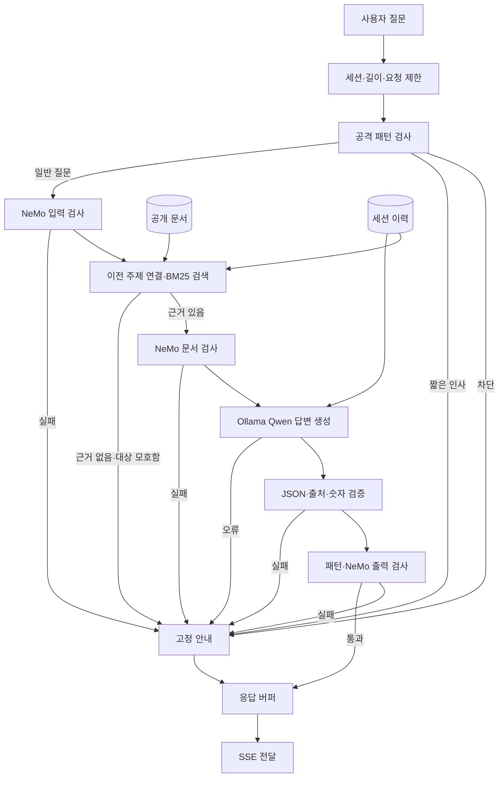

# Personal Persona Chatbot

소개, 경력, 프로젝트를 담은 JSON 파일을 바탕으로 답하는 개인용 AI 챗봇입니다. Ollama에서 Qwen을 실행하고, 질문에 필요한 공개 자료를 찾아 답변과 출처를 함께 보여줍니다. 같은 파일로 포트폴리오 화면의 이름, 소개, 프로젝트 카드도 설정합니다.

개인화는 프로필과 말투를 프롬프트에 반영하고 문서를 검색하는 방식입니다. 모델 가중치를 학습하거나 LoRA를 만드는 기능은 없습니다. 기본 예제의 인물 **윤서진**과 프로젝트는 모두 허구입니다.

## 시작하기

Python **3.11~3.13**과 [Ollama](https://ollama.com)가 필요합니다. 저장소를 내려받고 루트 디렉터리에서 다음 명령을 실행합니다. Node.js와 별도 데이터베이스는 필요하지 않습니다.

먼저 모델을 준비합니다.

```shell
ollama pull qwen3.5:2b-q4_K_M
ollama list
```

Ollama가 실행 중이 아니라면 별도 터미널에서 `ollama serve`를 실행합니다. 이미 Ollama 앱이 실행 중이면 서버를 하나 더 띄울 필요는 없습니다.

**Windows / PowerShell**

```powershell
py -3.13 -m venv .venv
.venv\Scripts\python -m pip install -r requirements.txt
.venv\Scripts\python -m uvicorn server.app:app --host 127.0.0.1 --port 8000 --workers 1
```

**macOS / Linux**

```bash
python3.13 -m venv .venv
.venv/bin/python -m pip install -r requirements.txt
.venv/bin/python -m uvicorn server.app:app --host 127.0.0.1 --port 8000 --workers 1
```

설치된 버전에 맞게 `3.13`을 `3.11` 또는 `3.12`로 바꿔도 됩니다. 실행 후 [localhost:8000](http://localhost:8000)에 접속합니다. 종료는 `Ctrl+C`입니다. 모델과 Python 패키지를 처음 받을 때는 네트워크가 필요하고, 기본 설정의 대화·안전성 검사는 로컬 Ollama에서 처리합니다.

예제에서는 다음 순서로 질문해 볼 수 있습니다.

```text
Atlas 프로젝트를 소개해 주세요.
사용한 기술은?
Orbit은?
좀 더 자세히 설명해 줘.
```

## 내 정보로 바꾸기

### 1. 개인 설정 파일 만들기

예제를 `knowledge/persona.local.json`으로 복사합니다. 아래 명령은 기존 개인 파일을 덮어쓰지 않습니다.

```powershell
# PowerShell
if (!(Test-Path knowledge/persona.local.json)) {
    Copy-Item knowledge/persona.example.json knowledge/persona.local.json
}
```

```bash
# macOS / Linux
[ -e knowledge/persona.local.json ] || cp knowledge/persona.example.json knowledge/persona.local.json
```

서버는 `PERSONA_PATH` 환경 변수, `knowledge/persona.local.json`, 기본 예제 순서로 파일을 선택합니다. 지정한 파일이 없거나 형식이 잘못되면 시작 단계에서 오류를 냅니다.

### 2. 프로필과 문서 작성하기

복사한 파일에서 이름과 소개를 바꾸고, `documents`에 공개할 내용을 작성합니다. 실제 프로필을 쓸 때는 `fictional`을 `false`로 바꿉니다.

| 필드 | 용도 |
| --- | --- |
| `name`, `english_name`, `role`, `location` | 이름, 역할, 지역 등 프로필 표시 |
| `headline`, `bio` | 첫 화면의 제목과 소개 |
| `tone` | 답변 말투 |
| `response_mode` | 기본 `persona`: 소유자 관점의 1인칭 AI / `assistant`: 소유자를 소개하는 안내자 |
| `suggested_questions` | 첫 화면에 표시할 질문 1~5개 |
| `documents` | 답변의 근거가 되는 문서 1~50개 |

두 답변 모드 모두 화면에 AI임을 표시합니다. 화면에만 적은 소개도 답변의 근거로 쓰려면 `documents`에 넣어야 합니다.

기본 예제는 윤서진의 입장에서 “저는…”, “제가 담당했습니다”처럼 답합니다. 기존 개인 파일에 `"response_mode": "assistant"`가 있으면 `"persona"`로 바꾸고 서버를 재시작하세요. 새 대화를 시작하면 이전 안내자 말투의 이력도 지워집니다. 허구 여부는 `fictional`과 화면 표시로 구분합니다.

문서 하나의 예시는 다음과 같습니다. `documents` 배열 안에 넣습니다.

```json
{
  "id": "nimbus",
  "title": "Nimbus",
  "category": "project",
  "visibility": "public",
  "summary": "공개 데이터를 탐색하는 도구입니다.",
  "text": "Nimbus는 Python으로 만든 공개 데이터 탐색 도구입니다. 데이터 정제와 API 설계를 담당했습니다.",
  "tags": ["Python", "데이터", "프로젝트"],
  "aliases": ["님버스"],
  "url": null
}
```

- `id`는 소문자 영문으로 시작하는 영문·숫자·하이픈 조합이며, 최대 64자입니다. 문서마다 달라야 합니다.
- `category`는 `about`, `career`, `skills`, `project`, `contact`, `other` 중 하나입니다.
- `summary`는 화면에 표시할 요약으로 최대 300자, `text`는 답변에 사용할 본문으로 최대 2,000자입니다.
- `aliases`에는 프로젝트의 다른 이름을 적습니다. 서로 다른 공개 프로젝트가 같은 별칭을 사용하면 검증에 실패합니다.
- `url`에는 HTTPS 주소를 넣습니다. `null`이거나 생략하면 해당 문서의 페이지 내 위치를 출처로 연결합니다.

전체 필드와 제한은 [JSON Schema](knowledge/persona.schema.json), 완성된 파일은 [기본 예제](knowledge/persona.example.json)를 참고하세요.

### 3. 검증하고 재시작하기

```powershell
.venv\Scripts\python -m server.validate_persona
```

macOS/Linux에서는 실행 경로를 `.venv/bin/python`으로 바꿉니다. 다른 파일을 검사하려면 명령 끝에 파일 경로를 붙입니다. 설정 파일은 UTF-8 JSON이며 최대 512 KiB입니다. 프로필·문서·검사 정책을 수정한 뒤에는 서버를 재시작해야 합니다.

## 자료와 대화는 어디에 남나

`visibility`는 문서마다 반드시 지정합니다. `public` 문서만 검색하고 모델에 전달합니다. 그 본문은 API에서 원문으로 내려주지 않더라도 챗봇 답변을 통해 공개될 수 있습니다. `private` 문서는 검색, 모델 입력, 출처, 공개 프로필 API에서 제외합니다.

최상위 프로필과 공개 문서의 제목·요약·태그·URL은 웹사이트에 표시됩니다. 개인 설정 파일은 암호화하지 않습니다. `private` 표시는 파일 업로드나 Git 추적을 막는 기능이 아닙니다.

저장소의 `.gitignore`는 `knowledge/`의 예제·스키마 외 파일과 `.env`, 가상환경, 로그를 제외합니다. 개인 파일을 다른 디렉터리에 둔다면 그 경로도 직접 제외해야 합니다. 이미 커밋한 파일과 과거 이력에는 제외 규칙이 소급 적용되지 않습니다.

대화는 서버 메모리에 최근 **최대 12턴·8,000자**를 보관합니다. 같은 세션에서는 새로고침 후 메시지를 복원하지만 출처 카드는 복원하지 않습니다. 새 대화, 마지막 채팅 요청 후 30분 만료, 서버 재시작 시 기억이 초기화됩니다. 차단되거나 검사·생성에 실패한 요청은 기억에 추가하지 않습니다.

앱 감사 로그에는 요청 ID, 상태, 사유 코드, 소요 시간만 남깁니다. 질문·답변 원문을 출력하는 NeMo logger는 비활성화했습니다. Ollama와 프록시의 로그 설정은 별도로 관리해야 합니다.

## 동작 방식



검색은 한글 bigram과 별칭을 사용하는 **인메모리 BM25**입니다. 선택한 공개 문서를 프롬프트에 넣는 RAG이며, 벡터 DB·임베딩·자동 청킹은 사용하지 않습니다. 최대 3개 문서와 최근 대화를 전달하고, 20,000 UTF-8 바이트 예산에 맞춰 오래된 대화 쌍부터 줄입니다. 이 예산은 실제 토큰 수를 측정한 값은 아닙니다.

Ollama에서는 전체 JSON 답변을 받은 다음 출처 ID, 숫자, 출력 안전성을 검사합니다. 검증을 마친 텍스트를 잘라 SSE로 전달하므로 모델의 원시 토큰을 실시간 중계하는 방식과는 응답 시작 시간이 다릅니다.

[NVIDIA NeMo Guardrails](https://github.com/NVIDIA-NeMo/Guardrails) **0.24.1**의 self-check action으로 입력·검색 문서·답변을 검사합니다. 검사에도 같은 Qwen을 사용하며 정상 생성 답변에는 최대 3회의 추가 추론이 필요합니다. 판정 형식 오류나 시간 초과가 나면 고정 안내로 종료합니다.

정책은 [prompts.yml](guardrails/prompts.yml), 빠른 차단 규칙은 [patterns.json](guardrails/patterns.json)에서 수정합니다. NeMo의 간접 의존성으로 FastEmbed와 ONNX Runtime도 설치되지만 이 앱에서 임베딩 모델을 실행하지는 않습니다. 적용 경계와 알려진 한계는 [가드레일 문서](docs/guardrails.md)에 정리했습니다.

## 실행 설정

환경 변수는 서버 실행 전에 지정합니다. [.env.example](.env.example)은 참고 파일이며 **`.env`를 자동으로 읽지 않습니다.**

| 변수 | 기본값 | 설명 |
| --- | --- | --- |
| `PERSONA_PATH` | 개인 파일이 있으면 선택, 없으면 예제 | 상대 경로는 저장소 루트 기준 |
| `OLLAMA_MODEL` | `qwen3.5:2b-q4_K_M` | 생성·검사에 함께 사용할 모델 |
| `OLLAMA_URL` | `http://127.0.0.1:11434` | Ollama 서버 origin |
| `PUBLIC_ORIGIN` | 요청의 base URL | 공개 운영 시 실제 HTTPS origin |
| `COOKIE_SECURE` | `0` | HTTPS 운영 시 `1` |

```powershell
# PowerShell
$env:PERSONA_PATH = "knowledge/persona.local.json"
```

```bash
# macOS / Linux
export PERSONA_PATH="knowledge/persona.local.json"
```

`OLLAMA_URL`을 원격 주소로 바꾸면 질문·공개 문서·대화 이력과 검사 대상도 그 서버로 전송됩니다. 다른 모델을 사용한다면 JSON Schema와 `think=false` 설정이 호환되는지 실제 대화 테스트로 확인하세요.

현재 세션·요청 제한·추론 lock은 한 프로세스의 메모리에 있습니다. **`--workers 1`로 실행해야 합니다.** 전체 활성 채팅은 최대 5개, 세션당 진행 요청은 1개이며, 검사와 생성 파이프라인도 한 번에 하나씩 실행합니다. lock 대기는 5초, 검사별 제한은 25초, 전체 검사·생성 제한은 125초입니다.

인터넷에 운영할 때는 HTTPS와 `PUBLIC_ORIGIN`, Secure 쿠키를 설정하고 신뢰할 프록시 범위를 제한해야 합니다. 익명 세션은 사용자 인증이 아닙니다. Ollama 포트를 직접 공개하지 마세요. Python 서버와 Ollama가 필요하므로 GitHub Pages만으로는 실행할 수 없습니다.

## HTTP API와 테스트

| Method | 경로 | 내용 |
| --- | --- | --- |
| `GET` | `/api/persona` | 공개 프로필과 문서 요약 |
| `POST` | `/api/session` | 익명 세션 쿠키 발급 |
| `GET` | `/api/session` | 해당 세션의 최근 메시지 |
| `DELETE` | `/api/session` | 세션과 쿠키 삭제 |
| `POST` | `/api/chat` | `{"message":"질문"}` → SSE |
| `GET` | `/health/live` | API 프로세스 상태 |
| `GET` | `/health/ready` | Ollama 모델 존재·completion 지원 확인, 실패 시 503 |

채팅 요청에는 세션 쿠키가 필요합니다. SSE의 `status`는 진행 상태, `delta`는 검증된 답변 조각, `done`은 최종 상태·출처·사유 코드, `error`는 처리 오류입니다. HTTP 200만으로 답변 성공을 판단하지 말고 `done.status`와 `done.reason_code`를 확인하세요. readiness는 10초 동안 캐시하며 실제 답변 품질을 검사하지 않습니다.

일반 회귀 테스트에는 Ollama가 필요하지 않습니다.

```powershell
.venv\Scripts\python -m pip install -r requirements-dev.txt
.venv\Scripts\python -m pip check
.venv\Scripts\python -m unittest discover -s tests -v
```

실제 서버와 모델을 확인하려면 Ollama를 켜고 다음을 실행합니다.

```powershell
.venv\Scripts\python tests/smoke_http.py
```

이 검사는 허구 예제와 임시 로컬 포트로 서버를 띄운 뒤 HTTP 요청만 보냅니다. 정적 파일, 상태 API, 세션 생성·격리·삭제, 잘못된 요청, 4턴 대화의 SSE·출처, 인젝션 차단을 확인하고 서버를 종료합니다. 개인 persona 파일은 사용하지 않습니다. 모델과 Ollama 주소는 환경 변수 설정을 따릅니다.

추가로 `tests/smoke_guardrails.py`는 공격·정상 입력 21개를 실제 모델로 검사하고, `tests/smoke_conversation.py`는 ASGI 테스트 클라이언트로 4턴 대화를 확인합니다. macOS/Linux에서는 위 명령의 Python 경로를 `.venv/bin/python`으로 바꾸면 됩니다.

`python tests/smoke_persona.py`는 실제 Qwen으로 자기소개·프로젝트 역할·경력이 3인칭 소개로 돌아가지 않는지 확인합니다.

2026-11-25 Windows/Python 3.13에서 회귀 테스트 **47개**와 실제 HTTP 검사를 통과했습니다. CI에는 Windows·Ubuntu·macOS와 Python 3.11·3.13 조합을 구성했습니다. 원격 CI 결과와 장시간 부하 성능은 별도로 확인해야 합니다.

## 저장소 구조

```text
server/                 FastAPI, persona 검증, 검색, 대화 기억, 추론
web/                    HTML·JavaScript·Tailwind 원본과 빌드된 CSS
knowledge/
  persona.example.json  공개 예제
  persona.schema.json   설정 스키마
  persona.local.json    직접 만드는 개인 파일, Git 제외
guardrails/             검사 정책과 공격 패턴
tests/                  회귀 테스트, HTTP·실제 모델 검사, 공격 사례
docs/                   상세 설계·운영·가드레일 문서
.github/workflows/      CI
requirements.txt        직접 의존성과 lock 참조
requirements.lock       런타임 간접 의존성 버전 고정
requirements-dev.txt    테스트 의존성
.env.example            환경 변수 예시
```

### UI 스타일 수정

`web/index.html`과 `web/app.js`의 Tailwind 클래스, `web/tailwind.css`를 수정합니다. [Tailwind standalone CLI v4.3.5](https://github.com/tailwindlabs/tailwindcss/releases/tag/v4.3.5)를 운영체제에 맞게 받아 다음처럼 빌드합니다.

```powershell
.venv\Scripts\python scripts/build_css.py --cli data/tools/tailwindcss-v4.3.5.exe
```

macOS/Linux에서는 해당 플랫폼 실행 파일에 실행 권한을 주고 `--cli`로 경로를 지정합니다. 빌드 결과인 `web/style.css`도 함께 커밋합니다. 실행 시에는 저장소의 CSS를 그대로 제공하므로 Node.js나 CDN이 필요하지 않습니다. 화면은 FastAPI의 정적 HTML로 제공하며 별도 JavaScript 프레임워크를 사용하지 않습니다.

## 문제 해결과 한계

| 증상 | 확인할 곳 |
| --- | --- |
| 서버가 시작되지 않음 | Python 버전, 의존성 설치, `python -m server.validate_persona`, 정책 YAML |
| 내 프로필이 나오지 않음 | `PERSONA_PATH` 우선순위 확인 후 서버 재시작 |
| `/health/ready`가 503 | Ollama 실행 여부와 `ollama list`의 모델 태그 |
| 채팅이 401 | 새 대화 시작. `localhost`와 `127.0.0.1`을 혼용하면 쿠키가 달라짐 |
| 403 | 브라우저 origin과 `PUBLIC_ORIGIN` 일치 여부 |
| 429 또는 `busy` | 진행 요청이나 요청 제한 창이 끝난 뒤 재시도 |
| `guard_unavailable` | 검사 모델 연결·시간 초과·판정 JSON 오류 |
| `unsafe_request`, `unsafe_context`, `unsafe_output` | 해당 단계에서 정책에 의해 차단. 정상 질문이면 정책과 회귀 사례를 함께 검토 |
| `invalid_output` | JSON·출처·숫자 검사 또는 입력 예산 확인 |
| `no_context` | 공개 문서에 근거를 추가하거나 프로젝트 이름·별칭을 명시 |

질문은 1,000자, HTTP 본문은 16 KiB로 제한합니다. 채팅은 세션당 분당 10회·IP당 30회, 세션 발급은 IP당 분당 20회입니다.

출처와 숫자가 일치해도 문장의 의미까지 사실이라고 보장할 수는 없습니다. 생성과 안전성 판정에 같은 소형 모델을 사용하므로 두 단계가 같은 공격에 실패할 수도 있습니다. 현재 공격 사례 검사는 회귀 확인용이며 전체 공격 탐지율을 나타내지 않습니다.

장기 기억, 여러 소유자, 파일 업로드, 자동 persona 추출, 이메일 발송과 예약은 구현하지 않았습니다. 후속 질문 연결은 규칙 기반이어서 복잡한 과거 참조에는 프로젝트 이름을 다시 지정해야 할 수 있습니다.

상세 내용은 [개발·운영 안내](docs/development.md)와 [가드레일 구성](docs/guardrails.md)을 참고하세요. [초기 설계](docs/plan.md)는 구현 전 제안을 보존한 문서이므로 현재 동작은 이 README를 기준으로 합니다.
