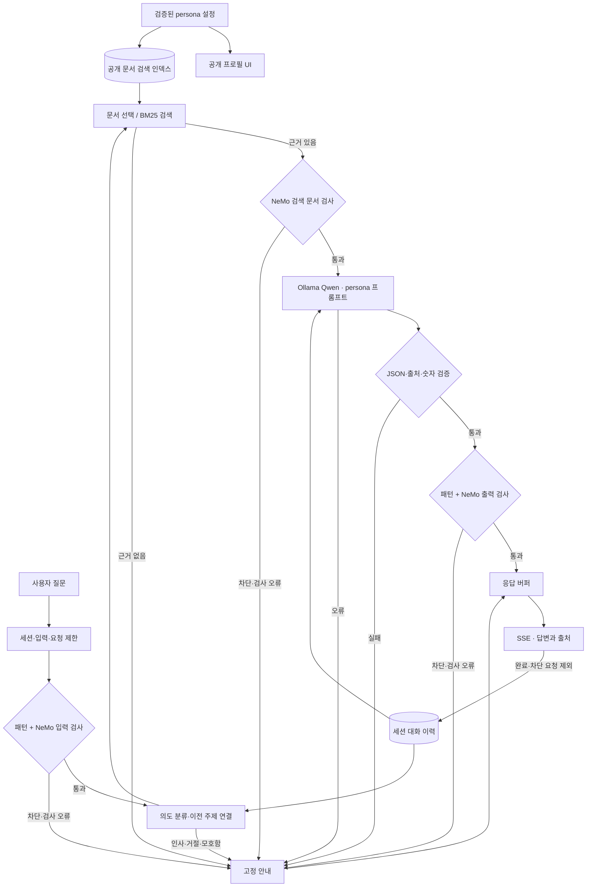

# Personal Persona Chatbot

**내 소개, 경험, 프로젝트를 바탕으로 답하는 로컬 AI persona 챗봇.**

Ollama에서 실행하는 Qwen 모델에 프로필과 공개 지식을 연결합니다. JSON 파일 하나로 인물, 말투, 답변 역할과 프로젝트를 설정하면 프롬프트·검색·포트폴리오 화면에 함께 적용됩니다. 방문자는 질문하고 답변의 출처를 확인할 수 있습니다.

기본 예제는 허구의 개발자 **윤서진**입니다. 현재는 단일 소유자·단일 서버 프로세스를 위한 MVP이며, 인터넷 공개 운영 전에는 배포 환경에 맞는 추가 검증이 필요합니다.

## Persona를 만드는 방식

개인화는 **프로필 설정 + 시스템 프롬프트 + RAG + 세션 이력**으로 이루어집니다. 모델 가중치를 재학습하지 않으며 파인튜닝, LoRA, Ollama Modelfile 생성은 포함하지 않습니다.

- `assistant`: 소유자를 소개하는 AI 안내자 역할.
- `persona`: 설정된 말투로 소유자의 관점에서 1인칭으로 답하는 AI persona 역할.

두 모드 모두 AI라는 표시와 문서 기반 검증을 유지합니다. 실제 사람처럼 행동하거나 연락·예약을 실행하는 기능은 없습니다.

## 주요 기능

- **로컬 추론:** 기본 모델 `qwen3.5:2b-q4_K_M`; 브라우저는 모델 서버에 직접 연결하지 않습니다.
- **설정 기반 UI:** 이름, 역할, 소개, 예시 질문과 프로젝트 카드가 같은 persona 파일에서 생성됩니다.
- **RAG와 출처:** 한글 bigram·별칭을 사용하는 BM25 검색과 문서 ID 기반 출처 검증.
- **대화 문맥:** 최근 최대 12턴·8,000자 및 현재 주제 유지, 후속 질문·주제 전환·재질문.
- **공개 범위 분리:** `private` 문서를 검색·모델 입력·화면 API에서 제외합니다.
- **NeMo Guardrails:** 로컬 Qwen으로 질문·검색 문서·답변을 검사하며, 검사 실패 시 고정 안내로 종료합니다.
- **검증 후 SSE:** 전체 JSON 답변의 형식·출처·숫자를 검사한 후 나누어 전달합니다.
- **운영 기반:** 요청 제한, 추론 동시성 제한, 연결 취소 처리, readiness와 회귀 테스트.

## 빠른 시작

Python **3.11~3.13**, Ollama, 이 저장소의 로컬 복사본이 필요합니다. Node.js와 별도 데이터베이스는 실행에 필요하지 않습니다.

### 1. 모델 준비

```shell
ollama pull qwen3.5:2b-q4_K_M
ollama list
```

Ollama가 실행 중이 아니라면 별도 터미널에서 `ollama serve`를 실행합니다. 모델 정보는 [Ollama 모델 페이지](https://ollama.com/library/qwen3.5:2b-q4_K_M)를 참고하세요.

### 2. 설치 및 실행

저장소 루트에서 실행합니다. 모델·패키지 최초 다운로드에는 네트워크가 필요합니다.

**Windows · PowerShell**

```powershell
python -m venv .venv
.venv\Scripts\python -m pip install -r requirements.txt
.venv\Scripts\python -m uvicorn server.app:app --host 127.0.0.1 --port 8000 --workers 1
```

**macOS / Linux · bash**

```bash
python3 -m venv .venv
.venv/bin/python -m pip install -r requirements.txt
.venv/bin/python -m uvicorn server.app:app --host 127.0.0.1 --port 8000 --workers 1
```

[http://127.0.0.1:8000](http://127.0.0.1:8000)을 열면 기본 데모가 표시됩니다. 종료는 `Ctrl+C`입니다.

```text
Atlas 프로젝트를 소개해 주세요.
→ 사용한 기술은?
→ Orbit은?
→ 좀 더 자세히 설명해 줘.
```

Windows/Python 3.13에서 로컬 검증했습니다. CI에는 Windows·Ubuntu·macOS와 Python 3.11·3.13 검증을 구성했으며 GitHub에서 실행 결과를 확인해야 합니다. 최소 RAM·VRAM 및 p95 응답 시간 벤치마크는 아직 제공하지 않습니다.

## 나만의 persona 만들기

### 1. 개인 파일 복사

기존 개인 파일을 덮어쓰지 않도록, **처음 한 번만** 예제를 복사합니다.

```powershell
# Windows PowerShell
if (!(Test-Path knowledge/persona.local.json)) {
    Copy-Item knowledge/persona.example.json knowledge/persona.local.json
}
```

```bash
# macOS / Linux
[ -e knowledge/persona.local.json ] || cp knowledge/persona.example.json knowledge/persona.local.json
```

선택 순서는 `PERSONA_PATH` 환경 변수 → `knowledge/persona.local.json` → 기본 예제입니다. 명시한 경로가 없거나 설정이 잘못되면 서버가 시작되지 않습니다. 잘못된 개인 설정 대신 데모를 조용히 사용하는 동작은 하지 않습니다.

`knowledge/`에서는 예제와 JSON Schema만 Git에 포함하도록 설정했습니다. `.env` 및 `.env.*`도 제외하며 `.env.example`만 포함합니다. 이미 추적된 파일이나 Git 이력은 `.gitignore`로 제거되지 않습니다.

### 2. 프로필과 공개 자료 편집

`knowledge/persona.local.json`을 수정합니다. 다음은 독립적으로 사용할 수 있는 최소 예제입니다.

```json
{
  "schema_version": 1,
  "fictional": false,
  "name": "김하늘",
  "english_name": "Haneul Kim",
  "role": "Data Engineer",
  "location": "Busan, South Korea",
  "headline": "데이터를 읽기 쉽게, 제품을 쓰기 편하게.",
  "bio": "공개 데이터를 이해하기 쉬운 도구로 만드는 개발자입니다.",
  "aliases": ["하늘"],
  "tone": "친근하고 간결하게, 근거를 구체적으로 설명합니다.",
  "response_mode": "persona",
  "suggested_questions": ["Nimbus는 어떤 프로젝트인가요?"],
  "documents": [
    {
      "id": "nimbus",
      "title": "Nimbus",
      "category": "project",
      "visibility": "public",
      "summary": "공개 데이터를 탐색하는 도구입니다.",
      "text": "Nimbus는 Python으로 개발한 공개 데이터 탐색 도구입니다. 김하늘은 데이터 정제와 API 설계를 담당했습니다.",
      "tags": ["데이터", "프로젝트", "Python"],
      "aliases": ["님버스"],
      "url": null
    }
  ]
}
```

이 예제의 인물·프로젝트 내용은 작성 형식을 보여주기 위한 예시입니다. 본인의 확인된 공개 정보로 바꿔 사용하세요.

| 설정 | 의미 |
| --- | --- |
| `name`, `english_name`, `role`, `location` | 화면과 프롬프트에 반영되는 인물 정보 |
| `headline`, `bio` | 첫 화면 소개. 모두 공개 표시됨 |
| `fictional` | 허구의 데모인지 여부. 화면과 시스템 지침에 반영 |
| `tone`, `response_mode` | 답변 말투 및 AI 안내자/1인칭 persona 역할 |
| `aliases` | 소유자 이름의 별칭 |
| `suggested_questions` | 화면에 표시할 질문 1~5개 |
| `documents` | 지식 문서 1~50개. 공개 문서가 최소 1개 필요 |

| 문서 필드 | 기준 |
| --- | --- |
| `id` | 소문자 영문으로 시작하는 영문·숫자·하이픈, 최대 64자. 전체 문서에서 고유해야 함 |
| `title`, `category` | 제목 및 `about`, `career`, `skills`, `project`, `contact`, `other` 중 하나 |
| `visibility` | 필수. `public` 또는 `private` |
| `summary` | 화면에 표시할 요약, 최대 300자 |
| `text` | 모델이 참조할 근거, 최대 2,000자 |
| `tags` | 검색 키워드, 최대 20개 |
| `aliases` | 프로젝트 별칭, 최대 10개. 서로 다른 공개 프로젝트 간 중복 불가 |
| `url` | 선택적인 HTTPS 출처 주소. 생략하거나 `null`이면 `/#doc-{id}` 자동 생성 |

프로젝트 이름, 개수와 별칭을 바꿔도 Python 또는 HTML을 수정할 필요가 없습니다. 화면에는 공개 문서의 요약이 표시되며 모델은 `text`를 근거로 답합니다. 소개·경력 같은 사실도 답변에 쓰려면 `documents`에 작성하세요.

### 3. 검증 및 재시작

```powershell
.venv\Scripts\python -m server.validate_persona
```

macOS/Linux에서는 실행 경로를 `.venv/bin/python`으로 바꿉니다. 다른 파일을 검사하려면 경로를 명시합니다.

```powershell
.venv\Scripts\python -m server.validate_persona knowledge/persona.local.json
```

검증기는 중복 ID·프로젝트 별칭, 빈 문서, 타입·길이, 공개 여부와 URL 형식을 확인합니다. 에러에는 필드 경로만 표시하고 입력 원문은 출력하지 않습니다. 전체 파일 크기는 512 KiB로 제한합니다. 자료 변경 후 서버를 재시작해야 검색과 화면에 반영됩니다.

전체 형식은 [persona.schema.json](knowledge/persona.schema.json), 완성된 예제는 [persona.example.json](knowledge/persona.example.json)을 참고하세요.

## 공개 범위와 기억

- 최상위 인물 정보, 질문 예시와 공개 문서의 제목·요약·태그·URL은 웹사이트에 표시됩니다.
- `public` 문서의 `text`는 API 원본 응답에는 포함되지 않지만 **챗봇 답변을 통해 공개될 수 있는 자료**입니다.
- `private` 문서는 검색·주제 연결·모델 입력·출처·화면 API에서 제외됩니다. 파일 자체는 암호화하지 않으므로 불필요한 비밀은 저장하지 마세요.
- 기본 설정에서는 로컬 Ollama로 추론합니다. `OLLAMA_URL`을 원격 서버로 바꾸면 질문, 선택된 공개 문서와 대화 이력도 그 서버에 전달됩니다.
- 안전성 검사도 같은 Ollama 서버·모델을 사용합니다. 차단되거나 검사를 완료하지 못한 요청·답변은 대화 기억에 추가하지 않습니다.
- 대화는 서버 메모리에 최근 최대 12턴·8,000자로 유지됩니다. 새로고침 시 같은 세션의 메시지를 복원합니다. 복원 메시지의 출처 카드는 별도로 저장하지 않습니다.
- 새 대화, 마지막 채팅 요청 후 30분 만료, 서버 재시작 시 문맥이 초기화됩니다. 만료 항목은 요청 시 및 최대 60초 간격의 정리 작업에서 삭제합니다.
- 앱 감사 로그는 요청 ID·상태·사유·소요 시간만 기록합니다. Uvicorn·프록시 접근 로그와 보관 정책은 운영자가 따로 설정해야 합니다.

개인 파일을 Git 제외 경로 밖에 둘 경우 해당 경로도 직접 제외하세요. `private` 값은 GitHub 업로드를 차단하는 기능이 아닙니다.

## 환경 변수

환경 변수는 서버 실행 전에 지정합니다. [.env.example](.env.example)은 참고용이며 `.env` 자동 로딩은 없습니다.

| 변수 | 기본값 | 설명 |
| --- | --- | --- |
| `PERSONA_PATH` | 개인 파일이 있으면 선택, 없으면 예제 | 상대 경로는 저장소 루트 기준 |
| `OLLAMA_MODEL` | `qwen3.5:2b-q4_K_M` | 설치된 모델 태그 |
| `OLLAMA_URL` | `http://127.0.0.1:11434` | 모델 서버 origin |
| `PUBLIC_ORIGIN` | 요청의 base URL | 공개 운영 시 실제 HTTPS origin으로 고정 |
| `COOKIE_SECURE` | `0` | HTTPS 운영 시 `1` |

```powershell
# PowerShell
$env:PERSONA_PATH = "knowledge/persona.local.json"
$env:OLLAMA_MODEL = "qwen3.5:2b-q4_K_M"
```

```bash
# bash
export PERSONA_PATH="knowledge/persona.local.json"
export OLLAMA_MODEL="qwen3.5:2b-q4_K_M"
```

추론은 `num_ctx=8192`, `num_predict=768`, `temperature=0.2`, `think=false`로 요청합니다. 다른 모델은 JSON Schema와 thinking 설정 지원을 확인하세요. [Ollama Chat API](https://docs.ollama.com/api/chat) 및 [Structured Outputs](https://docs.ollama.com/capabilities/structured-outputs)를 참고할 수 있습니다.

## 처리 흐름



Ollama의 원시 토큰을 중계하지 않습니다. `stream: false`로 전체 JSON을 받은 뒤 검증된 텍스트만 나누어 보내는 가상 스트리밍입니다. 생성 중에는 상태 이벤트와 heartbeat를 보냅니다.

검색은 인메모리 BM25이며 벡터 DB·임베딩·자동 청킹은 사용하지 않습니다. 모델 입력에는 최대 3개 공개 문서와 최근 이력을 넣습니다. 20,000 UTF-8 바이트 예산을 넘으면 오래된 대화 쌍부터 제거하며 현재 질문과 문서만으로 초과하면 생성 대신 안내로 종료합니다. 이는 실제 Qwen 토큰 수를 보장하는 계산은 아닙니다.

## 가드레일

[NVIDIA NeMo Guardrails](https://github.com/NVIDIA-NeMo/Guardrails)의 `self_check_input`·`self_check_output` action을 **0.24.1**로 고정해 직접 호출합니다. 질문, 검색 문서, 생성 답변에 서로 다른 정책을 적용합니다. 전체 NeMo 대화 엔진 대신 가드 action만 사용하며, 검색과 대화 기억은 이 앱이 관리합니다.

| 검사 위치 | 적용 내용 |
| --- | --- |
| 사용자 입력 | 정규화한 한·영 공격 패턴 + NeMo self-check. 이전 대화는 문맥 해석에만 사용 |
| 검색 결과 | 선택한 공개 문서의 제목·본문을 검사하여 문서에 삽입된 지시문 차단 |
| 생성 답변 | JSON·출처·숫자 검증 → 인젝션·비밀 형태 패턴 → NeMo self-check → SSE |
| 검사 실패 | 시간 초과, 연결 오류, 누락·잘못된 타입의 판정은 `guard_unavailable`. 답변·출처·이력에 초안을 남기지 않음 |

정확히 일치하는 짧은 인사와 고정 fallback은 모델 검사를 호출하지 않습니다. 정상 생성 답변에는 최대 **3회의 검사 추론**이 추가됩니다. 외부 API 키나 추가 모델 다운로드는 필요 없으며 `OLLAMA_MODEL`을 바꾸면 검사 모델도 함께 바뀝니다.

정책은 [guardrails/prompts.yml](guardrails/prompts.yml), 빠른 차단 규칙은 [guardrails/patterns.json](guardrails/patterns.json)에 있습니다. 파일 수정 후 서버를 재시작하고 정상 질문과 공격 사례를 함께 재검증하세요. NeMo의 간접 의존성으로 FastEmbed·ONNX Runtime도 설치되지만, 이 앱에서는 임베딩 모델이나 벡터 DB를 실행하지 않습니다.

**별도 학습된 인젝션 탐지기를 적용한 것은 아닙니다.** 현재 구성은 Qwen을 판정자로 사용하는 self-check와 패턴 검사입니다. 작은 모델의 오판, 다국어·인코딩 우회, 장기 대화 공격을 모두 막는다고 보장하지 않습니다. 비공개 자료 제외와 도구 실행 금지는 별도 경계로 유지합니다. 선택 근거와 검증 범위는 [가드레일 문서](docs/guardrails.md)에 정리했습니다.

## API

| Method | Path | 역할 |
| --- | --- | --- |
| `POST` | `/api/session` | 익명 세션 생성 또는 유효 세션 사용 |
| `GET` | `/api/session` | 해당 쿠키 세션의 최근 메시지 복원 |
| `DELETE` | `/api/session` | 대화 상태와 쿠키 삭제 |
| `GET` | `/api/persona` | 공개 표시용 프로필·섹션만 반환. 원문·private 문서·tone 제외 |
| `POST` | `/api/chat` | `{"message": "질문"}`을 받아 SSE 응답 |
| `GET` | `/health/live` | API 프로세스 응답 확인 |
| `GET` | `/health/ready` | Ollama의 해당 모델 존재·completion 지원 확인. 10초 캐시, 준비 안 되면 503 |

채팅에는 세션 쿠키가 필요합니다. SSE 이벤트는 `status`, `delta`, `done`, `error`이고 `done.sources`는 `{id, title, url}` 목록입니다. readiness는 실제 추론 품질·GPU 여유·출력 형식까지 검증하지 않습니다.

기본 제한은 본문 16KB, 질문 1,000자, 세션당 10회/분, IP당 30회/분, 세션 발급 IP당 20회/분입니다. 전체 활성 채팅은 최대 5개, 세션당 1개입니다. 검사와 답변 생성은 같은 lock을 사용해 한 대화의 파이프라인만 실행합니다. lock 대기 5초, 검사당 25초, 답변 생성 HTTP timeout 45초, 검사·생성 전체 125초를 상한으로 둡니다.

## 저장소 구조

```text
├── README.md
├── requirements.txt          # 직접 의존성 + lock constraints
├── requirements.lock         # 런타임 간접 의존성 버전 고정
├── requirements-dev.txt      # 테스트용 의존성
├── .env.example
├── .github/workflows/ci.yml
├── guardrails/               # NeMo 정책 프롬프트 및 한·영 차단 패턴
├── knowledge/
│   ├── persona.example.json  # 공개 가능한 허구 예제
│   ├── persona.schema.json   # 설정 JSON Schema
│   └── persona.local.json    # 사용자가 생성, Git 제외
├── server/
│   ├── app.py                # 앱 팩토리, 세션, API, SSE, health
│   ├── config.py             # 환경 변수와 경로 선택
│   ├── persona.py            # 스키마 및 공개 표시 경계
│   ├── validate_persona.py    # 설정 검증 CLI
│   ├── retrieval.py          # 공개 문서 BM25 검색
│   ├── conversation.py       # 이력과 주제 연결
│   ├── guardrails.py         # NeMo action·로컬 Ollama adapter·차단 처리
│   └── engine.py             # persona 프롬프트, 추론, 출력 검증
├── web/                      # 빌드 없는 HTML·CSS·JavaScript
├── tests/                    # API·설정·격리·문맥·취소 테스트
└── docs/                     # 원 설계 및 개발 기록
```

## 개발 및 테스트

테스트용 의존성을 설치합니다. 실제 모델을 호출하지 않는 회귀 테스트에는 Ollama가 필요하지 않습니다.

```powershell
.venv\Scripts\python -m pip install -r requirements-dev.txt
.venv\Scripts\python -m pip check
.venv\Scripts\python -m unittest discover -s tests -v
```

macOS/Linux에서는 `.venv/bin/python`을 사용합니다. Node.js가 있다면 `node --check web/app.js`로 클라이언트 구문을 검사할 수 있습니다.

실제 Ollama로 기본 예제의 4턴 대화를 검증하려면 다음을 실행합니다. 개인 파일과 관계없이 공개 예제를 사용합니다.

```powershell
.venv\Scripts\python tests/smoke_conversation.py
.venv\Scripts\python tests/smoke_guardrails.py
```

테스트는 다른 인물·프로젝트, 비공개 데이터 격리, 잘못된 설정, 세션 격리, 문맥 유지, 검증 전 본문 미노출, 연결 취소와 용량 제한을 다룹니다. 모델 출력의 모든 사실성을 보장하는 것은 아닙니다. 의존성을 변경할 때는 직접 의존성과 lock을 함께 갱신하고 새 가상환경 및 CI에서 확인하세요.

## 문제 해결

| 증상 | 확인할 사항 |
| --- | --- |
| 서버가 설정 오류로 시작되지 않음 | `python -m server.validate_persona`로 필드 경로와 스키마 확인 |
| 프로필 변경이 반영되지 않음 | 경로 우선순위 확인 후 서버 재시작 |
| 이전 `knowledge/persona.json`이 적용되지 않음 | 새 스키마로 변환해 `persona.local.json`에 저장. [이전 데이터 이전 안내](docs/development.md) 참고 |
| 모델 연결 실패 | Ollama 실행, `ollama list`, 모델 태그와 `/health/ready` 확인 |
| 401 | 새 대화 시작, 쿠키 확인. `localhost`와 `127.0.0.1` 혼용 방지 |
| 403 | 브라우저 origin과 `PUBLIC_ORIGIN` 확인 |
| 429 / 503 | 진행 요청 또는 요청 제한 창이 끝난 뒤 재시도 |
| 답변 대신 fallback | JSON·출처·숫자 검사 실패 또는 입력 예산 초과 가능. 문서와 질문을 구체화 |
| 후속 질문 대상이 어긋남 | 프로젝트 이름·별칭을 명시. 규칙 기반 연결의 한계일 수 있음 |

## 운영 범위와 한계

GitHub에 소스를 공개하는 것과 웹 서버를 인터넷에 배포하는 것은 별도입니다. 현재는 **단일 worker**로 실행합니다. 다중 프로세스에는 공유 세션·제한 저장소와 중앙 추론 큐가 필요합니다.

공개 운영 시 HTTPS, 고정 `PUBLIC_ORIGIN`, Secure 쿠키, 신뢰할 프록시 주소와 SSE 버퍼링 설정을 적용하세요. 익명 세션은 실제 사용자 인증을 제공하지 않습니다. Ollama 포트는 인터넷에 직접 공개하지 않으며 GitHub Pages만으로 Python과 Ollama를 실행할 수는 없습니다.

패턴 검사·NeMo self-check·숫자·출처 검증으로 모든 인젝션과 환각을 막을 수는 없습니다. 장기 대화·복잡한 과거 참조·한국어 의미 검색, 실제 토크나이저 기반 예산, 지속 부하와 성능 목표 검증은 추가 개선 대상입니다. 파일 업로드, 자동 persona 추출, 영구 기억, 여러 소유자, 메시지 발송·예약은 제공하지 않습니다.

## 문서

- [개발 안내](docs/development.md): 검증, 데이터 이전과 운영 설정.
- [가드레일](docs/guardrails.md): 오픈소스 선택, 검사 경계, 검증과 한계.
- [초기 설계](docs/plan.md): 최초 제안과 목표. 구현되지 않은 내용도 포함합니다.
